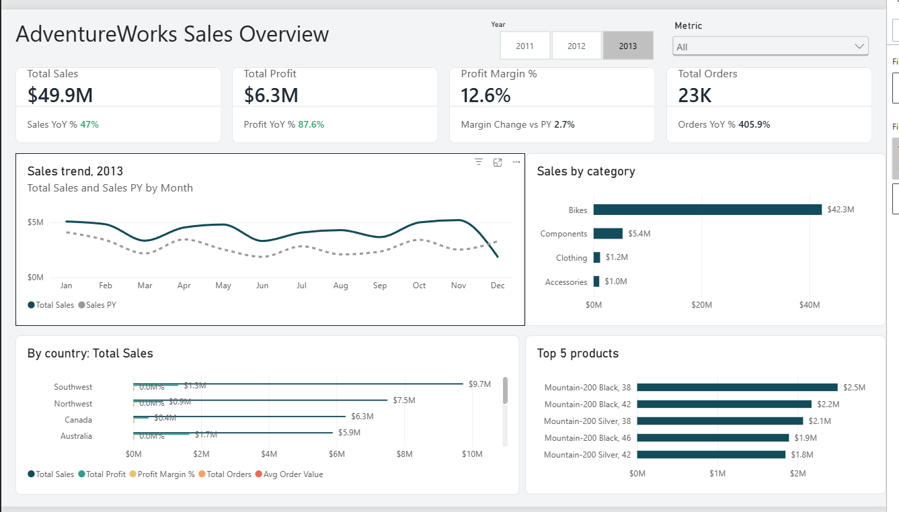
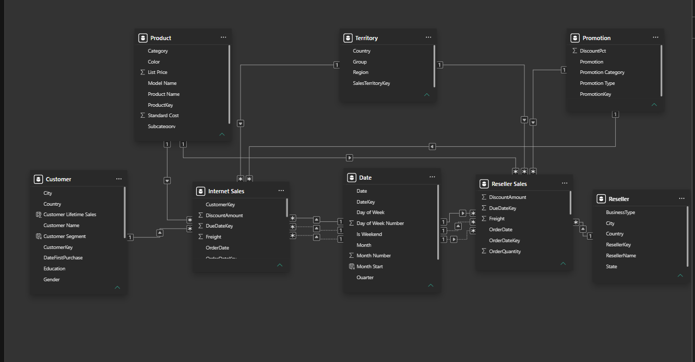
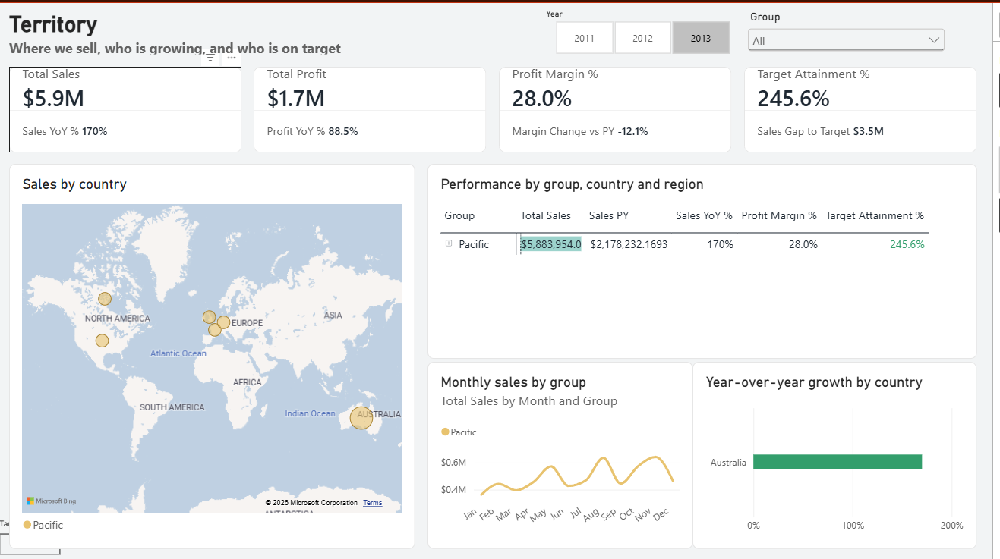

# AdventureWorks Power BI Showcase

A six-page Power BI report built on the **AdventureWorksDW2022** data warehouse. The project focuses on clean data modeling, time intelligence DAX, row-level security, and report design.



## What this project shows

- A clean **star schema** with two fact tables (internet and reseller sales) sharing product, territory, promotion and date dimensions
- **Time intelligence** that keeps working under a year slicer: prior year, YTD, prior year YTD, rolling 12 months, moving average
- **Role-playing dates** (order, ship, due) using `USERELATIONSHIP`
- **Row-level security** with static roles and a dynamic role driven by a security table
- A **what-if parameter** for sales targets, a **field parameter** metric switcher, dynamic titles and conditional formatting
- A consistent **custom theme** and layout across all pages

## Report pages

| Page | What it answers | Highlights |
|---|---|---|
| Overview | How are sales and profit trending? | KPI cards with YoY, monthly trend vs prior year, sales by category, metric switcher |
| Sales Performance | How does growth build through the year? | YTD vs prior year YTD, monthly YoY, rolling 12 months, order date vs ship date |
| Products | What drives sales and profit? | Drill-down matrix, Pareto chart, margin vs sales scatter |
| Customers | Who buys, and are they new or returning? | New vs returning customers, value segments, income bands, top customers |
| Territory | Where do we sell, and are we on target? | Map, target attainment with a what-if slider, regional matrix, RLS demo |
| About | How is it built? | Model diagram, data notes, selected DAX |

## Data model



- **Facts:** `Internet Sales`, `Reseller Sales`
- **Dimensions:** `Product` (category and subcategory flattened in), `Customer`, `Reseller`, `Territory`, `Promotion`, `Date`
- **Date table:** built in DAX, marked as the date table, with active order-date relationships and inactive ship-date and due-date relationships
- **Helper tables:** `_measures` (all measures), `Metric` (field parameter), `Target Growth` (what-if), `Security` (RLS lookup)

Snowflaked product and geography tables from the warehouse were flattened in Power Query so the model stays a true star schema.

## Key numbers (2013)

| Metric | Value |
|---|---|
| Total sales | $49.9M (+46.7% vs 2012) |
| Total profit | $6.3M (+87.6% vs 2012) |
| Profit margin | 12.6% |
| Bikes share of sales | 84.7% |
| Highest margin category | Accessories (53.0%) |
| Lowest margin category | Components (6.1%) |
| Internet sales | $16.4M (+179.9% vs 2012) |
| Share of customers who were new | 71.9% |

## Selected DAX

Prior year that survives a year slicer:

```dax
Sales PY =
IF([Has Data] = 1,
    CALCULATE([Total Sales],
        SAMEPERIODLASTYEAR('Date'[Date]),
        REMOVEFILTERS('Date'[Year])))
```

New customers (first order falls inside the selected period):

```dax
New Customers =
VAR StartD = MIN('Date'[Date])
VAR EndD = MAX('Date'[Date])
RETURN
COUNTROWS(
    FILTER(
        VALUES('Internet Sales'[CustomerKey]),
        VAR FirstOrder =
            CALCULATE(MIN('Internet Sales'[OrderDate]), REMOVEFILTERS('Date'))
        RETURN FirstOrder >= StartD && FirstOrder <= EndD
    )
)
```

Pareto running total:

```dax
Cumulative Sales % (Model) =
VAR CurrentSales = [Total Sales]
VAR AllModels = ALLSELECTED(Product[Model Name])
VAR RunningTotal =
    SUMX(FILTER(AllModels, [Total Sales] >= CurrentSales), [Total Sales])
VAR GrandTotal = CALCULATE([Total Sales], ALLSELECTED(Product[Model Name]))
RETURN DIVIDE(RunningTotal, GrandTotal)
```

Sales by ship date (role-playing dimension):

```dax
Sales by Ship Date =
CALCULATE(
    [Total Sales],
    USERELATIONSHIP('Internet Sales'[ShipDateKey], 'Date'[DateKey]),
    USERELATIONSHIP('Reseller Sales'[ShipDateKey], 'Date'[DateKey])
)
```

Dynamic row-level security filter on `Territory`:

```dax
'Territory'[Group] IN
    SELECTCOLUMNS(
        FILTER('Security', 'Security'[UserEmail] = USERPRINCIPALNAME()),
        "g", 'Security'[Group]
    )
```

## Row-level security

Four roles are defined on the `Territory` table:

| Role | Filter |
|---|---|
| North America | `[Group] = "North America"` |
| Europe | `[Group] = "Europe"` |
| Pacific | `[Group] = "Pacific"` |
| Regional Manager | Dynamic, matches `USERPRINCIPALNAME()` against the `Security` table |

The `Security` table uses fictional example emails. Because both fact tables relate to `Territory`, one filter restricts internet and reseller sales together.



**Limitation:** "Publish to web" does not enforce row-level security, and anyone with the `.pbix` file can see all the data. This is a demonstration of the technique, not a data protection setup.

## Data notes

- **Only 2011 to 2013 are full years.** Orders start on 2010-12-29 and end on 2014-01-28, so the report filters to 2011 through 2013. Year-over-year comparisons only make sense for 2012 and 2013.
- **Customers relate to internet sales only.** Resellers are businesses and have no customer records, so the Customers page uses internet sales.
- **Source row counts:** 60,398 internet sales rows and 60,855 reseller sales rows.

## How to run it

1. Install SQL Server (Developer edition is free) and SSMS.
2. Download the AdventureWorksDW sample from Microsoft's [sql-server-samples releases](https://github.com/Microsoft/sql-server-samples/releases/tag/adventureworks). Restore the `AdventureWorksDW2022.bak` file, or run the install script.
3. Open `pbix/AdventureWorks.pbix` in Power BI Desktop.
4. If your server name differs from `localhost`, go to **Transform data > Data source settings** and change the source.
5. Select **Refresh**.

Data files such as `.bak` and `.csv` are excluded from the repo through `.gitignore`.

## Repo structure

```
AdventureWorks/
  pbix/          Power BI report file
  theme/         Custom report theme (aw-theme.json)
  screenshots/   Page screenshots and model diagram
  docs/          Business questions and notes
  data/          Local data extracts (not committed)
```

## Tools

SQL Server 2022, Power Query (M), DAX, Power BI Desktop, Git

## Author

**Ahmed Hamdi Hegazi**
Data analyst, New Cairo, Egypt
[LinkedIn](https://linkedin.com/in/ahmed-hamdi-hegazi) | [GitHub](https://github.com/AHAH000) | [Portfolio](https://ahah000.github.io)
